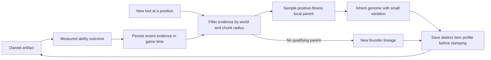

# Local artifact inheritance

This is the reproduction foundation for the evolutionary ecosystem. New equipment gets
its own persistent profile and can descend from a successful nearby artifact. Existing
physical items keep their profiles through trades. This is not yet a demonstration of
all four emergence criteria in the decision ledger.



## Locality and evidence

```yaml
ecology:
  inheritance-radius-chunks: 20
  inheritance-outcome-window-ticks: 6000
```

Radius is configured in **chunks**, defaults to 20, and is read from the current runtime
settings for each birth. It defines a same-world horizontal circle around the loot's
actual generation position. Twenty chunks corresponds to a distance of 320 blocks;
there is no block-unit configuration or whole-map/server fallback. Chunk-grid boundaries
do not partition the population. The evidence window is an implementation default of
6000 game ticks (five minutes at 20 TPS), not a separately owner-selected duration.
Both settings must be positive; nonpositive values are rejected without replacing the settings snapshot.

Only finite, matching, live measured outcomes from per-item profiles enter this pool.
Unknown positions and offline classifications cannot qualify a parent. Ordinary block
and player events provide positions; other effect implementations can attach a precise
`WorldPosition` through `AbilityEventContext.withPosition(...)`. The pool contains no
ability IDs or handler-specific branches.

For each candidate, observations outside the radius or evidence window are removed
before scoring. The existing outcome classifier replays those observations, retaining
its consecutive-repeat and no-op penalties. Parent fitness is mean validated utility
per attempt. Its base relevance is neutral: the old niche-lock, adoption and competition
multipliers do not enter reproduction fitness. The existing classifier still assigns
outcome weights; those weights and delivered reports remain proxies for usefulness.

Positive-fitness parents are sampled proportionally to their fitness. No population
quota, diversity floor, forced parent or global fallback is added. Without a qualifying
parent the item becomes a new founder lineage. A missing recorded parent profile refuses
the birth rather than inventing replacement ancestry. Replaced seeds and evolved revisions
retain separately attributable history but cannot reuse it as current reproductive fitness.
Changing measured success while keeping location and selection
randomness fixed changes which lineage the offspring inherits.

## Persistent individuals and variation

Each new item has a distinct `artifact:<uuid>` key and a nonzero signed seed. Offspring
inherit the parent's expressed/latent genome, activated latent traits, family affinities
and lineage, with the parent's item key, signed seed, revision and generation recorded. Ordinary small variation
uses the existing genome mutation operation at its minimum active strength; no additional
wild-mutation roll is introduced. Offspring reputation and personal history start fresh.
Ability generation reads the stored genome rather than rebuilding it solely from the seed.

Natural loot and first enchantment stamp existing, untracked, single equipment items
recognized by `EquipmentArchetype`. Ordinary materials, stacks and already tracked items
are untouched. The listener never creates an item or changes the loot list. Unclaimed
loot can inherit from its generation position without a player entity. Admin give and
convert paths also create distinct profiles. Convert and explicit identity replacements
preserve the held stack's other metadata through cloning.

Profiles must save before stamping. A failed birth save leaves vanilla loot unstamped.
If a later listener cancels generation or stamping fails after saving, an unused profile
can remain; it has no measured evidence and cannot qualify as a reproductive parent.
No cleanup infers destruction of a player's item from inactivity or an unloaded chunk.

Current gameplay activates the main-hand artifact. Switching flushes the old outcome
window, clears transient combat context and binds the new item's reputation. Combat,
boss/death processing and ordinary outcomes read that resolved item's reputation directly;
a trade changes holder without replacing
ancestry, genome, seed or history. Simultaneous worn/offhand artifact activation is not
implemented here. The next activation design covers passive effects, off-hand/secondary
click, armor/elytra and required PlaceholderAPI/LuckPerms support; see
[Equipment and ability activation design](equipment-ability-activation.md).
Old player-scoped tags are not automatically migrated or restamped;
there is no existing player data to migrate. Legacy player-store APIs remain for older
offline tests and tooling, but tracked live items cannot fall back to them.

## Storage and lifecycle

SQL stores per-item serialized profiles in `artifact_profiles` and the evidence/clock in
`ecology_state`. YAML stores item profiles separately and uses atomic replacement for
profiles and ecology snapshots. Both use the same extracted artifact/reputation codec.
Incomplete profiles, invalid traits and malformed evidence are refused. Ecology corruption
at startup follows the fatal storage-initialization path; runtime item failures use the
existing load guard and retry backoff. Failed saves remain retryable and are logged.
Per-item and ecology formats are version 3, with genetic revisions, transition markers,
expressed/latent genes, activation flags and revision-specific measured fitness; see
`durable-genome-evolution.md` and `revision-specific-fitness.md`. No existing-player-data migration is supplied.

The inheritance clock advances with the scheduler's game ticks and persists with the
outcome evidence at autosave/shutdown. Downtime does not advance it. An abrupt crash can
lose changes since the last completed autosave. Profile writes and snapshots are currently
synchronous; production latency has not been measured. Ecology snapshots assume one server
writer; coordination between servers is not implemented. A bounded clean/inactive profile
cache preserves active and dirty entries; eviction never deletes durable artifacts or
limits the ecological population.

## Validation and remaining ecosystem work

Focused tests exercise exact radius/world boundaries, evidence locality, restart/expiry,
repeat penalties, corruption, causal outcome swaps, inherited genes, distinct items,
trade persistence, held-item boss/death attribution, cache/save/load failures, real loot
events and item conservation.
They use API doubles and controlled measured outcomes; no game server was deployed.
Final full `clean package`: 469 tests across 91 classes, zero failures/errors/skips,
Maven exit 0, 23:07. All 487 source/resource/build-file hashes matched the tested
manifest afterward. Focused verification: 91 passing. Canonical skill status records
the publication and merge boundary separately.

Expiry means loss of **recent reproductive eligibility**, not proof of lineage extinction.
Owned dormant items remain. The owner subsequently required genes to change real ability
performance and tradeoffs. The first follow-up expresses Double Jump output/recovery and
measures response/cost; other effects remain fixed/configurable. Read
[heritable ability performance](heritable-ability-performance.md) for scope and validation.

Natural niche formation, broader heritable performance, measured lineage extinction,
co-evolving environmental pressure and removal/ablation of the old selection aids remain
necessary before claiming a fully functioning emergent ecosystem. The old fixed event
rotation and niche machinery are not removed or presented as proof by this slice.
